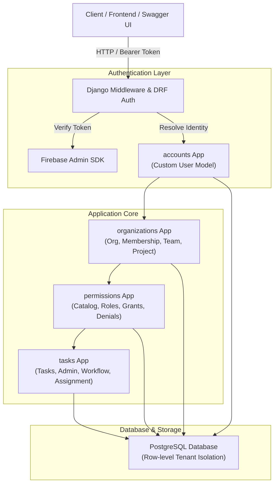

# TeamLink — Multi-Tenant Task Management Platform

[](https://www.djangoproject.com/)
[](https://www.django-rest-framework.org/)
[](https://www.postgresql.org/)
[](https://firebase.google.com/)
[](https://drf-spectacular.readthedocs.io/)
[](https://www.python.org/)

**TeamLink** is a multi-tenant task management platform designed to orchestrate personal tasks, teams, projects, organizations, and dynamic workflows. The platform pairs enterprise-grade data isolation and fine-grained, action-based permissions with collaborative task workflows.

Developed incrementally as a practical learning journey in **Django**, **PostgreSQL database design**, **Firebase Authentication**, **REST API development**, and **multi-tenant authorization**.

---

## Table of Contents

- [Core Features](#core-features)
- [Technology Stack](#technology-stack)
- [System Architecture](#system-architecture)
- [Project Structure](#project-structure)
- [Getting Started (Windows PowerShell)](#getting-started-windows-powershell)
- [Documentation Index](#documentation-index)
- [Development Roadmap](#development-roadmap)
- [Current Project Status](#current-project-status)

---

## Core Features

- **Multi-Tenant Data Isolation:** Independent organization tenants with strict foreign key constraints and query filtering. Users can belong to multiple organizations without data cross-contamination.
- **Hybrid Task Management:** Seamless handling of **Personal Tasks** (private, individual ownership) and **Project Tasks** (collaborative, team-scoped, workflow-driven) using a unified, validated model.
- **Task Administration Safeguards:** Strict enforcement that every task must have an assigned **Task Admin** before assignees can be added.
- **Dynamic Action-Based Permissions:** Flexible RBAC/ABAC model supporting platform-, organization-, team-, project-, and task-level scopes, explicit denials, and time-bounded delegation.
- **Configurable Workflows:** Organizations define baseline workflows; projects can override them with customized states and transition rules.
- **Firebase Authentication Integration:** Firebase handles identity verification (email/password, OAuth), while Django handles profile resolution, tenant membership, and authorization.
- **OpenAPI 3.0 Documentation:** Interactive API exploration via Swagger UI and ReDoc powered by `drf-spectacular`.

---

## Technology Stack

| Layer | Technology | Version | Purpose |
| :--- | :--- | :--- | :--- |
| **Backend Framework** | Django | 5.2.18 | Core Web Framework, ORM, Migrations |
| **API Framework** | Django REST Framework (DRF) | 3.18.3 | Serializers, ViewSets, API Views |
| **Database** | PostgreSQL | 15+ / 16+ | Relational Data Store, Constraints |
| **Database Adapter** | psycopg (psycopg3) | 3.3.6 | Native binary Python driver for PostgreSQL |
| **Authentication** | Firebase Authentication | Admin SDK 6.5+ | Client authentication, token verification |
| **API Docs & Schemas** | drf-spectacular | 0.30.0 | OpenAPI 3.0 schema generation & Swagger UI |
| **Runtime Environment** | Python | 3.13.14 | Execution runtime |
| **Shell & OS** | Windows PowerShell | Windows 10/11 | Development scripting and automation |

---

## System Architecture

TeamLink divides responsibilities into four modular Django applications:



### Module Responsibilities

1. **`accounts`**:
   - Custom User model (`AbstractUser`) keyed on email and Firebase UID.
   - User profile management and account activation state.
   - Global identity shared across multiple organizations.

2. **`organizations`**:
   - Organization tenant lifecycle and slug-based routing.
   - User memberships (`OrganizationMembership`) with status.
   - Teams within organizations (`Team`, `TeamMembership`).
   - Project workspaces enforcing strict organization boundaries.

3. **`permissions`**:
   - Fine-grained action catalog (e.g., `task.create`, `task.assign`, `workflow.configure`).
   - Scopes: `Platform`, `Organization`, `Team`, `Project`, `Task`.
   - Dynamic custom roles, reusable permission bundles, explicit denials, and delegated authority.

4. **`tasks`**:
   - Personal vs. Project task lifecycle.
   - Task Admin designated requirements prior to assignment.
   - Subtasks, dependencies, assignments, comments, and activity audit trails.
   - Configurable status workflows and transition validation.

---

## Project Structure

```text
TeamLink/
├── README.md                          # Project overview and quick start guide
├── docs/                              # Deep-dive architecture and design specifications
│   ├── ARCHITECTURE.md                # System design, tenant isolation, and app boundaries
│   ├── DATA_MODELS.md                 # Entity definitions, schemas, and Mermaid ER diagram
│   ├── PERMISSIONS_AND_WORKFLOWS.md   # Dynamic permissions, scopes, and workflow engine
│   ├── AUTHENTICATION_AND_SECURITY.md # Firebase Auth integration, token flow, security rules
│   ├── API_SPECIFICATION.md           # REST API conventions, endpoints, Swagger docs
│   ├── DATABASE_INTEGRITY_AND_RULES.md# PostgreSQL constraints, business rules, Task Admin invariant
│   └── DEVELOPMENT_ROADMAP.md         # Phased implementation plan and learning guide
└── server/                            # Django project backend root
    ├── manage.py                      # Django CLI utility
    ├── requirements.txt               # Pinned Python package dependencies
    ├── .venv/                         # Python 3.13 virtual environment
    ├── config/                        # Project configuration directory
    │   ├── __init__.py
    │   ├── settings.py                # Django settings (DB, installed apps, DRF, auth)
    │   ├── urls.py                    # Master URL routing
    │   ├── asgi.py
    │   └── wsgi.py
    ├── accounts/                      # Identity & user app
    ├── organizations/                 # Tenants, memberships, teams, projects (Phase 3)
    ├── permissions/                   # Dynamic action-based permissions (Phase 4)
    └── tasks/                         # Tasks, workflows, assignments (Phase 5-6)
```

---

## Getting Started (Windows PowerShell)

### Prerequisites

- **Python 3.13+** installed and available in `PATH`.
- **PostgreSQL 15+** installed locally or running in a container.
- **Firebase Project** configured with Authentication enabled.

### 1. Clone & Navigate to Project

```powershell
cd c:\Users\LINTO\Projects\TeamLink
```

### 2. Activate Virtual Environment

A virtual environment already exists under `server/.venv`:

```powershell
# Set execution policy if running scripts is restricted
Set-ExecutionPolicy -ExecutionPolicy RemoteSigned -Scope Process

# Activate virtual environment
.\server\.venv\Scripts\Activate.ps1
```

### 3. Install Dependencies

```powershell
pip install -r .\server\requirements.txt
```

### 4. Configure Environment Variables

Create a `.env` file in the `server/` directory:

```env
SECRET_KEY=your-django-secret-key-here
DEBUG=True
ALLOWED_HOSTS=localhost,127.0.0.1

# PostgreSQL Database Configuration
DB_NAME=teamlink_db
DB_USER=postgres
DB_PASSWORD=your_db_password
DB_HOST=localhost
DB_PORT=5432

# Firebase Credentials
FIREBASE_CREDENTIALS_PATH=./config/firebase_service_account.json
```

### 5. Create PostgreSQL Database

In PowerShell (using PostgreSQL CLI `psql`):

```powershell
psql -U postgres -c "CREATE DATABASE teamlink_db;"
```

### 6. Run Migrations & Development Server

```powershell
cd server
python manage.py makemigrations
python manage.py migrate
python manage.py runserver
```

Access the API and documentation:
- **Server:** `http://127.0.0.1:8000/`
- **Django Admin:** `http://127.0.0.1:8000/admin/`
- **Swagger UI:** `http://127.0.0.1:8000/api/docs/`
- **OpenAPI Schema:** `http://127.0.0.1:8000/api/schema/`

---

## Documentation Index

Explore the comprehensive project documentation in the [`docs/`](./docs/) directory:

- [**Functional Requirements Specification (`docs/FUNCTIONAL_REQUIREMENTS.md`)**](./docs/FUNCTIONAL_REQUIREMENTS.md) — Authoritative functional scope, actor definitions, requirements catalogue (ACC, ORG, PRJ, TSK, ASN, PER), and acceptance criteria.
- [**System Architecture (`docs/ARCHITECTURE.md`)**](./docs/ARCHITECTURE.md) — Multi-tenancy patterns, app layering, and service isolation.
- [**Core Data Models (`docs/DATA_MODELS.md`)**](./docs/DATA_MODELS.md) — Schema definitions, relational keys, and complete Mermaid ER diagram.
- [**Dynamic Permissions & Workflows (`docs/PERMISSIONS_AND_WORKFLOWS.md`)**](./docs/PERMISSIONS_AND_WORKFLOWS.md) — Action catalog, 5-level scoping, explicit denials, and project workflow engines.
- [**Authentication & Security (`docs/AUTHENTICATION_AND_SECURITY.md`)**](./docs/AUTHENTICATION_AND_SECURITY.md) — Firebase token lifecycle, DRF authentication backend, and zero-trust policies.
- [**API Specification (`docs/API_SPECIFICATION.md`)**](./docs/API_SPECIFICATION.md) — RESTful endpoints, payload structures, pagination, and Swagger UI integration.
- [**Database Integrity & Rules (`docs/DATABASE_INTEGRITY_AND_RULES.md`)**](./docs/DATABASE_INTEGRITY_AND_RULES.md) — Task Admin prerequisites, assignment validation, and cross-tenant safeguards.
- [**Development Roadmap & Learning Guide (`docs/DEVELOPMENT_ROADMAP.md`)**](./docs/DEVELOPMENT_ROADMAP.md) — Incremental phases, Django educational concepts, and progress tracker.

---

## Development Roadmap

```
Phase 1: Foundation (Settings, PostgreSQL, Base Config)          [IN PROGRESS]
Phase 2: Accounts (Custom User Model, Firebase Token Auth)      [PENDING]
Phase 3: Organizations (Tenants, Memberships, Teams, Projects)  [PENDING]
Phase 4: Dynamic Permissions (Action Catalog, Scoped Grants)    [PENDING]
Phase 5: Tasks Engine (Personal vs Project, Task Admin, Assign) [PENDING]
Phase 6: Workflows Engine (Custom Statuses, Guard Transitions)  [PENDING]
Phase 7: Notifications & Auditing (Events, Preferences)         [PENDING]
Phase 8: API Polish & Production Readiness (Docs, Automated Tests) [PENDING]
```

---

## Current Project Status

- **Phase 1 Foundation Underway:**
  - Django 5.2.18 project initialized in `server/config`.
  - Virtual environment `.venv` configured with Python 3.13.14.
  - Dependencies pinned in `server/requirements.txt`.
  - `accounts` app registered for custom user model implementation.
  - Architecture and domain documentation codified in `docs/`.

**Immediate Next Step:** Complete the custom `User` model in `server/accounts/models.py`, configure `AUTH_USER_MODEL = 'accounts.User'` in `settings.py` before applying initial migrations, and establish PostgreSQL database connection.
# Task-Manager-Project
