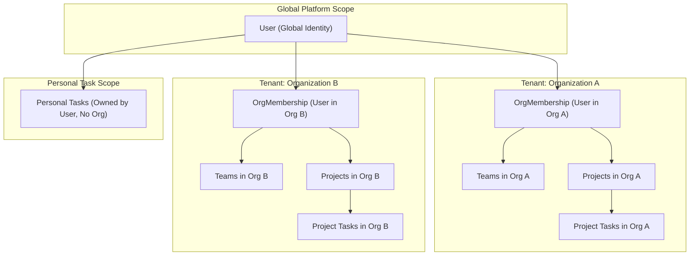
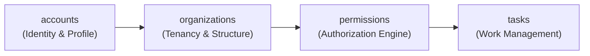
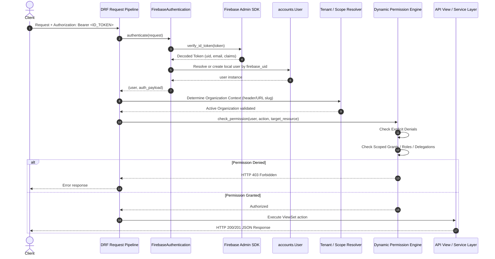

# TeamLink — System Architecture & Multi-Tenancy Design

## 1. Architectural Philosophy

TeamLink is architected as an **enterprise-grade, multi-tenant task management platform** built with **Django 5.2.18** and **Django REST Framework 3.18.3**.

The architecture balances two foundational requirements:
1. **Strict Data Isolation:** Guaranteeing that independent organizations (tenants) cannot view, modify, or leak each other's projects, tasks, teams, or operational metadata.
2. **Unified User Identity:** Enabling a single user to create an account, log in once via Firebase Authentication, and participate in multiple distinct organizations with different roles and permissions in each.

---

## 2. Multi-Tenancy Model: Row-Level Isolation

Multi-tenancy can generally be achieved via three strategies:
- **Database-per-tenant:** High operational overhead, separate database instances per tenant.
- **Schema-per-tenant (PostgreSQL schemas):** Complex migration management, dynamic schema switching on each request.
- **Row-level isolation (Shared Database, Shared Schema):** Every tenant-scoped entity carries a foreign key to `Organization`. Data access is partitioned logically via database foreign keys, composite indexes, unique constraints, and ORM query scoping.

### Chosen Approach: Row-Level Multi-Tenancy

TeamLink uses **Row-Level Multi-Tenancy** for the following architectural reasons:
- **Seamless Cross-Organization Accounts:** A `User` record exists once globally, and connects to organizations via `OrganizationMembership`.
- **Streamlined Migrations:** Standard Django migrations apply uniformly to one PostgreSQL database schema without managing dynamic schema migrations.
- **Resource Efficiency:** Shared database connection pooling via `psycopg` optimizes database resources.
- **Enforced Tenant Boundaries:** Database-level composite foreign keys and constraints guarantee that child records (such as `Project`, `Team`, and project-level `Task`) always match the parent organization.



---

## 3. Four Core Applications

The backend codebase is organized into four decoupled Django apps:



### 3.1 `accounts` App
- **Primary Goal:** User identity, authentication mapping, and global account attributes.
- **Core Entities:** `User` (subclassing `AbstractUser`), `UserProfile`.
- **Key Responsibilities:**
  - Map external `firebase_uid` to the internal Django primary key.
  - Synchronize basic user profile data (email, name, active status).
  - Provide custom DRF authentication backend (`FirebaseAuthentication`).
  - Remain agnostic of organization-specific business rules.

### 3.2 `organizations` App
- **Primary Goal:** Organizational hierarchy, tenant scoping, and membership rosters.
- **Core Entities:** `Organization`, `OrganizationMembership`, `Team`, `TeamMembership`, `Project`.
- **Key Responsibilities:**
  - Create and manage organizations with unique URL slugs.
  - Maintain user association with organizations (`OrganizationMembership`).
  - Organize users into functional teams (`Team`).
  - Manage projects (`Project`) as collaborative workspaces tied strictly to an organization.

### 3.3 `permissions` App
- **Primary Goal:** Granular, action-based authorization engine replacing rigid role silos.
- **Core Entities:** `PermissionAction`, `Role`, `PermissionBundle`, `ScopedGrant`, `ExplicitDenial`, `Delegation`.
- **Key Responsibilities:**
  - Define atomic actions (e.g., `task.create`, `task.assign`, `workflow.configure`).
  - Support multi-tier scoping: `Platform`, `Organization`, `Team`, `Project`, and `Task`.
  - Evaluate access requests via a deterministic precedence engine:
    $$\text{Explicit Denial} > \text{Direct Grant} > \text{Role Grant} > \text{Scope Inheritance} > \text{Default Deny}$$
  - Allow time-bounded delegation of administrative and operational rights.

### 3.4 `tasks` App
- **Primary Goal:** Task lifecycle, collaboration, workflows, and task assignments.
- **Core Entities:** `Task`, `TaskAssignment`, `Subtask`, `TaskComment`, `Workflow`, `WorkflowStatus`, `WorkflowTransition`.
- **Key Responsibilities:**
  - Support **Personal Tasks** (private to owner, nullable organization) and **Project Tasks** (scoped to project and organization).
  - Enforce the **Task Admin Invariant**: A task *must* have an assigned Task Admin before team members can be assigned to it.
  - Execute configurable workflow state machines with transition validation.
  - Maintain audit history of assignments and status changes.

---

## 4. Request Lifecycle & Security Pipeline

Every incoming HTTP request follows a strict verification pipeline before executing view logic:



---

## 5. Tenant Isolation Principles

To prevent tenant data contamination, TeamLink enforces isolation across three layers:

1. **Database Schema Constraints:**
   - Composite unique constraints and foreign keys guarantee that dependent entities cannot reference parent entities from another tenant.
   - Example: A task's `project.organization_id` must match `task.organization_id`.

2. **Custom QuerySet Scoping (Django ORM):**
   - All tenant-scoped models utilize a custom `TenantManager` and `TenantQuerySet`.
   - Views automatically scope base querysets:
     ```python
     def get_queryset(self):
         return Task.objects.filter(organization=self.request.active_organization)
     ```

3. **Backend Service Validation:**
   - Never trust IDs provided solely in request bodies.
   - When assigning a task to a user, the system verifies that the assignee possesses an active `OrganizationMembership` within the task's organization.
