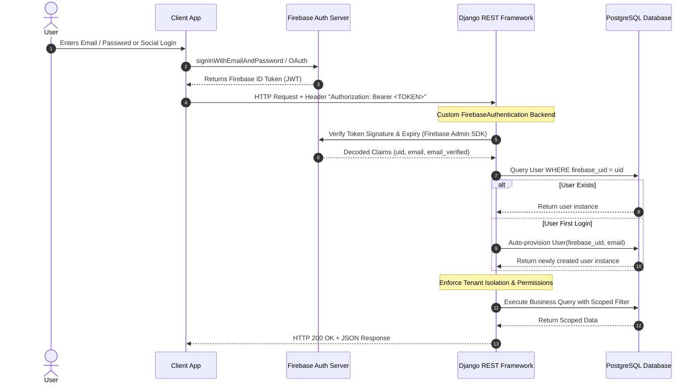

# TeamLink — Authentication & Security Architecture

## 1. Authentication Overview

TeamLink uses a hybrid security model:
- **Firebase Authentication:** Handles user identity verification, multi-factor authentication, social OAuth sign-ins (Google, Microsoft, GitHub), password resets, and token issuance on the client side.
- **Django & DRF:** Manages application data, multi-tenant boundaries, action-based permissions, user profiles, and business logic execution.



---

## 2. DRF Firebase Authentication Backend

The authentication workflow is encapsulated inside a custom DRF authentication class (`server/accounts/authentication.py`):

```python
from rest_framework import authentication, exceptions
from firebase_admin import auth as firebase_auth
from django.contrib.auth import get_user_model

User = get_user_model()

class FirebaseAuthentication(authentication.BaseAuthentication):
    """
    Validates Firebase ID Token from the Authorization: Bearer <token> header.
    Resolves or provisions the local Django User record.
    """
    def authenticate(self, request):
        auth_header = request.headers.get('Authorization')
        if not auth_header or not auth_header.startswith('Bearer '):
            return None

        id_token = auth_header.split('Bearer ')[1].strip()
        try:
            # Cryptographically verify token and check revocation
            decoded_token = firebase_auth.verify_id_token(id_token, check_revoked=True)
            uid = decoded_token.get('uid')
            email = decoded_token.get('email', '')
        except Exception as exc:
            raise exceptions.AuthenticationFailed(f"Invalid Firebase Token: {str(exc)}")

        # Resolve local user by firebase_uid
        user, created = User.objects.get_or_create(
            firebase_uid=uid,
            defaults={
                'email': email,
                'username': email or uid,
                'is_active': True,
            }
        )
        return (user, decoded_token)
```

---

## 3. Server-Side Security Policies

### 3.1 Zero-Trust Client Payload Policy
- **Never trust client-asserted identity or roles:** The client cannot pass an `organization_id` or `role` in the request body to bypass permissions. All access rights are resolved on the backend using the authenticated `request.user` and active database memberships.
- **Strict Tenant Verification:** Every request to `/api/organizations/{org_slug}/...` checks that `request.user` possesses an active `OrganizationMembership` in that specific organization.

### 3.2 Token Expiry & Revocation
- Firebase ID tokens expire after 1 hour.
- The backend checks `check_revoked=True` during token verification to reject tokens if a user was disabled, suspended, or had their credentials revoked in Firebase.

### 3.3 Secrets Management
- Sensitive keys (`SECRET_KEY`, database credentials, Firebase service account paths) are loaded strictly via environment variables (`.env`).
- Never commit Firebase service account `.json` keys or `.env` files to source control. `.gitignore` must explicitly include:
  ```text
  .env
  *.json
  !package.json
  !tsconfig.json
  ```

### 3.4 Rate Limiting & Throttling
DRF throttles protect API endpoints against brute force and denial of service:
```python
REST_FRAMEWORK = {
    'DEFAULT_THROTTLE_CLASSES': [
        'rest_framework.throttling.AnonRateThrottle',
        'rest_framework.throttling.UserRateThrottle',
    ],
    'DEFAULT_THROTTLE_RATES': {
        'anon': '100/day',
        'user': '1000/hour',
    }
}
```

### 3.5 CORS & CSRF
- **CORS (Cross-Origin Resource Sharing):** Configured via `django-cors-headers` to permit only authorized client frontend domains.
- **CSRF (Cross-Site Request Forgery):** Because client applications use stateless `Authorization: Bearer <token>` headers instead of session cookies, CSRF risks for REST API endpoints are naturally mitigated. Django's session-based CSRF protection remains enabled for the Django Admin interface.
