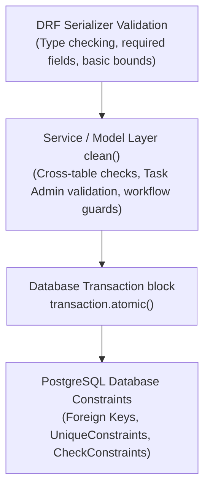

# TeamLink — Database Integrity & Business Rules Specification

## 1. Multi-Layer Integrity Architecture

To prevent data corruption, orphaned records, and security breaches, TeamLink splits enforcement across three layers:
1. **Database Level (PostgreSQL):** Foreign keys, unique constraints, and check constraints enforce invariants that never change.
2. **Model & Service Level (Django):** `clean()` methods, custom managers, and transaction services enforce cross-table validation before saving.
3. **API Serializer Level (DRF):** Validates incoming payload types, format, and initial invariants before hitting the business layer.



---

## 2. Core Business Invariants

### 2.1 One Membership Per User & Organization
A user can join multiple organizations, but cannot be added more than once to the same organization.
- **PostgreSQL Enforcement:**
  ```python
  class Meta:
      constraints = [
          models.UniqueConstraint(
              fields=['organization', 'user'],
              name='unique_org_user_membership'
          )
      ]
  ```

### 2.2 Cross-Organization Isolation
Entities belonging to different tenants must never be cross-linked.
- **Rules:**
  - A `TeamMembership` cannot add a user who is not an active member of `team.organization`.
  - A `Task` assigned to a `Project` must have `task.organization == project.organization`.
  - A `parent_task` must belong to the exact same `project` and `organization` as the child `subtask`.
- **Validation in Model `clean()`:**
  ```python
  def clean(self):
      super().clean()
      if self.project and self.organization:
          if self.project.organization_id != self.organization_id:
              raise ValidationError("Task organization must match project organization.")
      if self.parent_task:
          if self.parent_task.project_id != self.project_id:
              raise ValidationError("Subtask must belong to the same project as parent task.")
  ```

---

## 3. Personal vs. Project Task Invariants

| Invariant | Personal Task | Project Task |
| :--- | :--- | :--- |
| **`project` field** | `None` (`NULL`) | Must reference a valid `Project` |
| **`organization` field** | `None` (`NULL`) | Must equal `project.organization` |
| **Visibility** | Private to `owner` by default | Visible to project members based on role |
| **Workflow** | Standard personal status | Inherits project or org workflow |
| **Assignment** | Typically owner only (or shared) | Multi-user assignments permitted |

> [!WARNING]
> Do not treat a missing `project` as sufficient proof that a task is personal. Always validate that `organization` is also `None` and verify the `owner` matches the requesting user.

---

## 4. Task Administration & Assignment Rules

Every collaborative task must adhere to strict administrative governance before work can be delegated:

### Rule 1: Designated Task Admin Requirement
**A task cannot have assignees added until a valid, active Task Admin is designated.**
- If `task.task_admin` is `NULL`, any attempt to create a `TaskAssignment` is rejected with `TASK_ADMIN_REQUIRED`.
- The Task Admin is accountable for task scoping, review, and assignment management.

### Rule 2: Authorized Designation
- Only authorized users (e.g. project managers with `task.manage_admin` or organization admins) can designate or reassign the `task_admin`.

### Rule 3: Valid Assignee Membership
- Every assignee must have an active `OrganizationMembership` within `task.organization`.
- If an assignee's membership is revoked or suspended, their active task assignments are automatically set to `REMOVED`.

### Rule 4: Duplicate Assignment Prevention
- A user cannot have multiple simultaneous active assignments on the same task:
  ```python
  models.UniqueConstraint(
      fields=['task', 'user'],
      condition=models.Q(status='ACTIVE'),
      name='unique_active_user_assignment_per_task'
  )
  ```

---

## 5. Subtask & Dependency Tree Safeguards

1. **Cycle Prevention:** A task cannot be its own parent (`parent_task_id != id`).
2. **Nesting Depth Limit:** Hierarchies are restricted to a maximum depth of 3 levels (e.g., Epic $\rightarrow$ Task $\rightarrow$ Subtask) to protect database recursive queries.
3. **Cascade Integrity:** Deleting a parent task with active subtasks requires explicit user confirmation (`CASCADE` with audit logging).

---

## 6. Atomic Transaction Safeguards

Operations that alter multiple tables must execute inside `transaction.atomic()`:
```python
from django.db import transaction

def assign_user_to_task(task, assignee, assigner):
    with transaction.atomic():
        # 1. Lock task row to prevent race conditions
        locked_task = Task.objects.select_for_update().get(id=task.id)
        
        # 2. Invariant check: Task Admin must exist
        if not locked_task.task_admin:
            raise ValidationError("Task Admin must be designated before assignment.")
            
        # 3. Create assignment record
        assignment = TaskAssignment.objects.create(
            task=locked_task,
            user=assignee,
            assigned_by=assigner,
            status='ACTIVE'
        )
        
        # 4. Record audit event
        AuditLog.objects.create(
            actor=assigner,
            action="task.assign",
            resource_type="Task",
            resource_id=locked_task.id,
            metadata={"assigned_user_id": assignee.id}
        )
        return assignment
```
