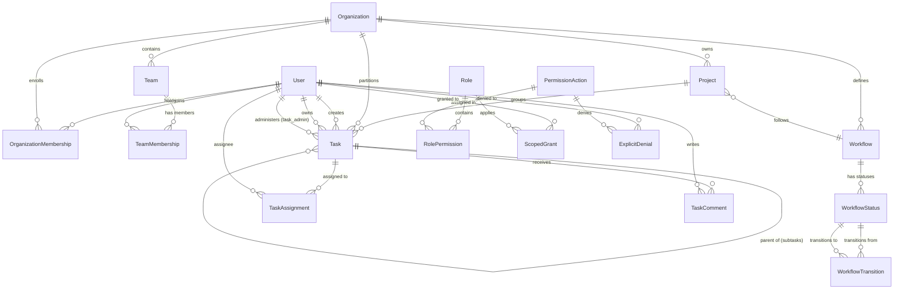

# TeamLink — Core Data Model & Database Schema Specification

## 1. Entity Relationship Overview

The TeamLink database schema connects global users to organizational tenants, dynamic permissions, workflows, and task lifecycles:

---

## 2. Accounts App Models

### 2.1 `User`
Extends Django's `AbstractUser` to integrate seamlessly with Firebase Authentication.

| Field Name | Type | Constraints / Attributes | Description |
| :--- | :--- | :--- | :--- |
| `id` | `BigAutoField` | Primary Key, Auto-increment | Unique internal surrogate identifier. |
| `firebase_uid` | `CharField(128)` | `unique=True`, `db_index=True` | Unique UID provided by Firebase Authentication. |
| `email` | `EmailField(254)` | `unique=True`, `db_index=True` | Primary contact and sign-in identifier. |
| `first_name` | `CharField(150)` | Blank allowable | User's given name. |
| `last_name` | `CharField(150)` | Blank allowable | User's family/surname. |
| `is_active` | `BooleanField` | Default: `True` | Flags whether user can authenticate. |
| `is_staff` | `BooleanField` | Default: `False` | Flags access to Django admin site. |
| `is_superuser` | `BooleanField` | Default: `False` | Platform-level superuser bypass flag. |
| `date_joined` | `DateTimeField` | Auto-set on creation | Account registration timestamp. |

> [!IMPORTANT]
> The custom user model replaces Django's default `auth.User` via `AUTH_USER_MODEL = 'accounts.User'` in `settings.py`. This configuration must be set before initial migrations are applied to prevent schema conflicts.

---

## 3. Organizations App Models

### 3.1 `Organization`
Represents an independent organizational tenant.

| Field Name | Type | Constraints | Description |
| :--- | :--- | :--- | :--- |
| `id` | `BigAutoField` | Primary Key | Unique tenant identifier. |
| `name` | `CharField(200)` | Required | Human-readable company or workspace name. |
| `slug` | `SlugField(220)` | `unique=True`, `db_index=True` | URL-safe identifier for tenant routing. |
| `description` | `TextField` | Blank allowable | Summary of organization's charter. |
| `is_active` | `BooleanField` | Default: `True` | Soft-disable switch for tenant access. |
| `created_at` | `DateTimeField` | `auto_now_add=True` | Tenant creation timestamp. |
| `updated_at` | `DateTimeField` | `auto_now=True` | Last modification timestamp. |

### 3.2 `OrganizationMembership`
Binds global users to an organization with membership state.

| Field Name | Type | Constraints | Description |
| :--- | :--- | :--- | :--- |
| `id` | `BigAutoField` | Primary Key | Membership surrogate identifier. |
| `organization` | `ForeignKey(Organization)` | `on_delete=CASCADE` | Target organization tenant. |
| `user` | `ForeignKey(User)` | `on_delete=CASCADE` | Associated platform user. |
| `status` | `CharField(30)` | Choices: `PENDING`, `ACTIVE`, `SUSPENDED` | Membership operational state. |
| `joined_at` | `DateTimeField` | `auto_now_add=True` | Timestamp when user accepted membership. |

**Indexes & Constraints:**
- `UniqueConstraint(fields=['organization', 'user'], name='unique_org_user_membership')` ensures a user cannot have duplicate memberships in the same organization.

### 3.3 `Team`
Functional subdivision of an organization (e.g., Engineering, Marketing, Operations).

| Field Name | Type | Constraints | Description |
| :--- | :--- | :--- | :--- |
| `id` | `BigAutoField` | Primary Key | Unique team identifier. |
| `organization` | `ForeignKey(Organization)` | `on_delete=CASCADE` | Parent organization. |
| `name` | `CharField(150)` | Required | Team name. |
| `description` | `TextField` | Blank allowable | Team mission or focus. |
| `created_at` | `DateTimeField` | `auto_now_add=True` | Creation timestamp. |

**Constraints:**
- `UniqueConstraint(fields=['organization', 'name'], name='unique_team_name_per_org')`.

### 3.4 `TeamMembership`
Connects organization members to specific internal teams.

| Field Name | Type | Constraints | Description |
| :--- | :--- | :--- | :--- |
| `id` | `BigAutoField` | Primary Key | Team membership record key. |
| `team` | `ForeignKey(Team)` | `on_delete=CASCADE` | Associated team. |
| `user` | `ForeignKey(User)` | `on_delete=CASCADE` | Member user. |
| `joined_at` | `DateTimeField` | `auto_now_add=True` | Assignment date. |

**Integrity Rule:** `clean()` and database validation verify that `user` belongs to `team.organization` before allowing membership creation.

### 3.5 `Project`
Collaborative workspace within an organization managing a specific deliverable or goal.

| Field Name | Type | Constraints | Description |
| :--- | :--- | :--- | :--- |
| `id` | `BigAutoField` | Primary Key | Unique project identifier. |
| `organization` | `ForeignKey(Organization)` | `on_delete=CASCADE` | Parent organization tenant. |
| `name` | `CharField(200)` | Required | Project title. |
| `description` | `TextField` | Blank allowable | Detailed project scope. |
| `created_by` | `ForeignKey(User)` | `on_delete=PROTECT` | Creator of the project. |
| `workflow` | `ForeignKey(Workflow)` | `null=True`, `on_delete=SET_NULL` | Assigned workflow state machine. |
| `is_archived` | `BooleanField` | Default: `False` | Archival flag. |
| `created_at` | `DateTimeField` | `auto_now_add=True` | Creation timestamp. |
| `updated_at` | `DateTimeField` | `auto_now=True` | Last modification timestamp. |

---

## 4. Tasks App Models

### 4.1 `Task`
Core entity modeling both **Personal Tasks** and **Project Tasks**.

| Field Name | Type | Constraints | Description |
| :--- | :--- | :--- | :--- |
| `id` | `BigAutoField` | Primary Key | Unique task identifier. |
| `title` | `CharField(255)` | Required | Action-oriented task title. |
| `description` | `TextField` | Blank allowable | Full specification and instructions. |
| `organization` | `ForeignKey(Organization)` | `null=True`, `blank=True`, `on_delete=CASCADE` | Null for personal tasks; set for project tasks. |
| `project` | `ForeignKey(Project)` | `null=True`, `blank=True`, `on_delete=CASCADE` | Null for personal tasks; mandatory for project tasks. |
| `created_by` | `ForeignKey(User)` | `related_name='tasks_created'` | Original author of the record. |
| `owner` | `ForeignKey(User)` | `related_name='tasks_owned'` | Primary owner of the task outcome. |
| `task_admin` | `ForeignKey(User)` | `null=True`, `related_name='tasks_administered'` | Designated administrator required for task assignment. |
| `parent_task` | `ForeignKey('self')` | `null=True`, `blank=True`, `related_name='subtasks'` | Self-referencing link for subtasks. |
| `status` | `CharField(50)` | Default: `'TODO'` | Current lifecycle stage. |
| `priority` | `CharField(20)` | Choices: `LOW`, `MEDIUM`, `HIGH`, `CRITICAL` | Task urgency ranking. |
| `due_date` | `DateTimeField` | `null=True`, `blank=True` | Target completion deadline. |
| `created_at` | `DateTimeField` | `auto_now_add=True` | Creation timestamp. |
| `updated_at` | `DateTimeField` | `auto_now=True` | Last update timestamp. |

### Integrity Rules for `Task`:
1. **Cross-Tenant Constraint:** If `project` is not null, `task.organization` must equal `project.organization`.
2. **Personal Task Rules:** If `project` is null and `organization` is null, the task is **Personal**. Personal tasks are private to `owner`.
3. **Subtask Hierarchy:** A `parent_task` must belong to the exact same project and organization. Subtask nesting depth is bounded to avoid circular dependency loops.

### 4.2 `TaskAssignment`
Represents one or more users actively working on a task.

| Field Name | Type | Constraints | Description |
| :--- | :--- | :--- | :--- |
| `id` | `BigAutoField` | Primary Key | Assignment record key. |
| `task` | `ForeignKey(Task)` | `on_delete=CASCADE`, `related_name='assignments'` | Target task. |
| `user` | `ForeignKey(User)` | `on_delete=CASCADE`, `related_name='task_assignments'` | Assigned worker. |
| `assigned_by` | `ForeignKey(User)` | `on_delete=PROTECT` | User who made the assignment (must be Task Admin or authorized). |
| `status` | `CharField(30)` | Choices: `ACTIVE`, `COMPLETED`, `REMOVED` | Assignment state. |
| `assigned_at` | `DateTimeField` | `auto_now_add=True` | Timestamp assignment was established. |

**Database Invariant:**
- `UniqueConstraint(fields=['task', 'user'], condition=Q(status='ACTIVE'), name='unique_active_task_assignment')` prevents assigning the same user concurrently multiple times.

---

## 5. Permissions App Models

### 5.1 `PermissionAction`
Catalog of fine-grained, atomic actions.

| Field Name | Type | Constraints | Description |
| :--- | :--- | :--- | :--- |
| `id` | `BigAutoField` | Primary Key | Action identifier. |
| `codename` | `CharField(100)` | `unique=True` | Dot-notation action (e.g. `task.assign`). |
| `name` | `CharField(150)` | Required | Human-readable name. |
| `category` | `CharField(50)` | Choices: `ORG`, `TEAM`, `PROJECT`, `TASK`, etc. | Action classification. |

### 5.2 `Role`
Custom collection of actions defined by an organization.

| Field Name | Type | Constraints | Description |
| :--- | :--- | :--- | :--- |
| `id` | `BigAutoField` | Primary Key | Role record key. |
| `organization` | `ForeignKey(Organization)` | `null=True`, `on_delete=CASCADE` | Null for global system roles; populated for org custom roles. |
| `name` | `CharField(100)` | Required | Role name (e.g., "Sprint Lead", "Reviewer"). |
| `actions` | `ManyToManyField(PermissionAction)` | Through table | Permitted action set. |

### 5.3 `ScopedGrant`
Assigns a Role or Permission to a User within an explicit scope.

| Field Name | Type | Constraints | Description |
| :--- | :--- | :--- | :--- |
| `id` | `BigAutoField` | Primary Key | Grant record key. |
| `user` | `ForeignKey(User)` | `on_delete=CASCADE` | Grant recipient. |
| `role` | `ForeignKey(Role)` | `null=True`, `on_delete=CASCADE` | Role bundle granted. |
| `action` | `ForeignKey(PermissionAction)` | `null=True`, `on_delete=CASCADE` | Direct action grant (if not using role). |
| `scope_type` | `CharField(30)` | Choices: `PLATFORM`, `ORGANIZATION`, `TEAM`, `PROJECT`, `TASK` | Scoping tier. |
| `scope_id` | `BigIntegerField` | Required (or `null` for Platform) | ID of target Org, Team, Project, or Task. |
| `granted_by` | `ForeignKey(User)` | `on_delete=PROTECT` | Authorizer. |
| `expires_at` | `DateTimeField` | `null=True`, `blank=True` | Expiration for temporary delegations. |

### 5.4 `ExplicitDenial`
Overrides any positive grants to enforce negative permissions.

| Field Name | Type | Constraints | Description |
| :--- | :--- | :--- | :--- |
| `id` | `BigAutoField` | Primary Key | Denial record key. |
| `user` | `ForeignKey(User)` | `on_delete=CASCADE` | Target user. |
| `action` | `ForeignKey(PermissionAction)` | `on_delete=CASCADE` | Specific action to deny. |
| `scope_type` | `CharField(30)` | Choices: `ORGANIZATION`, `TEAM`, `PROJECT`, `TASK` | Scope of the denial. |
| `scope_id` | `BigIntegerField` | Target resource ID | ID of scoped entity. |
| `reason` | `TextField` | Blank allowable | Administrative reason for revocation/denial. |
