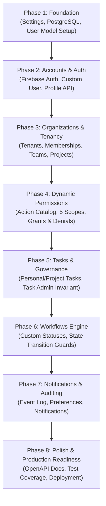

# TeamLink — Phased Development Roadmap & Learning Guide

## 1. Incremental Implementation Philosophy

TeamLink is structured as a step-by-step educational project. Each phase introduces new architectural patterns, database concepts, and security practices.



---

## 2. Phase-by-Phase Roadmap

### Phase 1 — Foundation & Infrastructure
- [x] Configure Python 3.13 virtual environment (`.venv`).
- [x] Pin dependencies in `requirements.txt` (Django 5.2.18, DRF 3.18.3, psycopg 3.3.6, drf-spectacular 0.30.0).
- [ ] Establish `.env` configuration for secrets and PostgreSQL settings.
- [ ] Connect Django to local PostgreSQL database via `psycopg`.
- [ ] Configure `AUTH_USER_MODEL = 'accounts.User'` in `config/settings.py` before running initial migrations.

> [!IMPORTANT]
> **Django Learning Rule:** Always configure `AUTH_USER_MODEL` *before* the first migration is run. Changing the user model mid-project requires dropping the database or intricate manual migration surgeries.

---

### Phase 2 — Accounts & Firebase Authentication
- [ ] Implement `User` model inheriting from `AbstractUser` with `firebase_uid` and `email` indexes.
- [ ] Create initial migration for `accounts` app.
- [ ] Build custom DRF `FirebaseAuthentication` backend.
- [ ] Build `/api/accounts/me/` endpoint to return current user profile.
- [ ] Write automated tests verifying valid token resolution, expired token rejection, and user auto-provisioning.

---

### Phase 3 — Organizations, Teams & Tenant Isolation
- [ ] Create `organizations` app (`python manage.py startapp organizations`).
- [ ] Implement models: `Organization`, `OrganizationMembership`, `Team`, `TeamMembership`, `Project`.
- [ ] Enforce unique constraint `(organization, user)` on memberships.
- [ ] Build custom `TenantQuerySet` and `TenantManager` to automate row-level scoping.
- [ ] Add CRUD endpoints for organizations, teams, and projects.
- [ ] Write negative security tests confirming User A cannot view Organization B's projects.

---

### Phase 4 — Dynamic Action-Based Permissions
- [ ] Create `permissions` app (`python manage.py startapp permissions`).
- [ ] Populate atomic action catalog (`PermissionAction`).
- [ ] Implement `Role`, `ScopedGrant`, `ExplicitDenial`, and time-bounded `Delegation`.
- [ ] Build the permission resolution service:
  $$\text{Explicit Denial} \succ \text{Task Grant} \succ \text{Project Grant} \succ \text{Team Grant} \succ \text{Org Grant} \succ \text{Default Deny}$$
- [ ] Implement custom DRF permission class `HasScopedActionPermission`.
- [ ] Test scoped grants, inheritance down the hierarchy, and explicit denials.

---

### Phase 5 — Tasks, Task Admin & Assignments
- [ ] Create `tasks` app (`python manage.py startapp tasks`).
- [ ] Implement `Task`, `TaskAssignment`, `Subtask`, and `TaskComment` models.
- [ ] Implement the **Personal vs. Project Task** separation logic.
- [ ] Implement the **Task Admin Invariant**: Block creation of `TaskAssignment` records if `task.task_admin` is null.
- [ ] Add assignment management endpoints guarded by atomic transactions (`transaction.atomic`).
- [ ] Write tests verifying Task Admin requirement, duplicate assignment blocking, and subtask parent integrity.

---

### Phase 6 — Configurable Workflows Engine
- [ ] Implement `Workflow`, `WorkflowStatus`, and `WorkflowTransition` models.
- [ ] Support Organization-default workflows and Project-level workflow overrides.
- [ ] Enforce state machine transition validation in `Task` serializer `update()` / service layer.
- [ ] Support transition permission guards (e.g. `task.approve` required for transition to "Completed").

---

### Phase 7 — Notifications & Auditing
- [ ] Implement `AuditLog` model recording `actor`, `action`, `resource_type`, `resource_id`, `scope`, and `metadata`.
- [ ] Implement event triggers on task assignments, status transitions, and administrative updates.
- [ ] Implement user notification preferences (email vs. in-app).
- [ ] Guard against leaking sensitive metadata or notifying users whose access has been revoked.

---

### Phase 8 — API Documentation & Production Readiness
- [ ] Complete OpenAPI 3.0 schema annotations with `@extend_schema` from `drf-spectacular`.
- [ ] Verify interactive Swagger UI (`/api/docs/`) and ReDoc (`/api/redoc/`).
- [ ] Run comprehensive test suite with coverage reporting.
- [ ] Performance profiling: Eliminate N+1 queries using `select_related()` and `prefetch_related()`.
- [ ] Finalize deployment checklists (HTTPS, CORS, environment variables, PostgreSQL connection pooling).

---

## 3. Essential Windows PowerShell Commands

### Environment Activation
```powershell
Set-ExecutionPolicy -ExecutionPolicy RemoteSigned -Scope Process
.\server\.venv\Scripts\Activate.ps1
```

### Database & Migrations
```powershell
cd c:\Users\LINTO\Projects\TeamLink\server

# Create migrations for a specific app
python manage.py makemigrations accounts

# Apply all migrations to PostgreSQL
python manage.py migrate

# Check migration status
python manage.py showmigrations
```

### Running Tests
```powershell
# Run all tests
python manage.py test

# Run tests for accounts app with verbosity
python manage.py test accounts -v 2
```

### Running Server
```powershell
python manage.py runserver
```

---

## 4. Key Django Concepts & Architectural Best Practices

### 1. `select_related()` vs. `prefetch_related()`
- **`select_related()`:** Performs an SQL `INNER JOIN` or `LEFT OUTER JOIN`. Used for single-valued relationships (`ForeignKey`, `OneToOneField`). Example: `Task.objects.select_related('project', 'organization')`.
- **`prefetch_related()`:** Executes a separate query and performs Python-side in-memory joining. Used for multi-valued relationships (`ManyToManyField`, reverse foreign keys). Example: `Task.objects.prefetch_related('assignments__user')`.
- **Why it matters:** Prevents the **N+1 Query Problem**, where iterating through 100 tasks generates 100 additional database queries.

### 2. Primary Keys: `BigAutoField` vs. UUIDs
TeamLink uses `BigAutoField` (64-bit integer auto-increment) for internal database primary keys:
- **Index Efficiency:** B-Tree indexes on 64-bit integers are significantly faster and more compact than 128-bit random UUIDs, avoiding disk page fragmentation on high-volume inserts.
- **External Slugs for URLs:** Public routing uses unique `slug` strings (e.g., `/api/organizations/acme-corp/`) rather than exposing internal sequential IDs.

### 3. Deletion Strategies (`on_delete`)
- **`models.CASCADE`:** Deleting the parent automatically deletes the children (e.g., deleting an Organization removes its Teams).
- **`models.PROTECT`:** Prevents parent deletion if related child records exist (e.g., cannot delete a User who created an active Project).
- **`models.SET_NULL`:** Sets the foreign key to `NULL` (e.g., when a custom workflow is deleted, project `workflow` is set to null, falling back to organization default).
