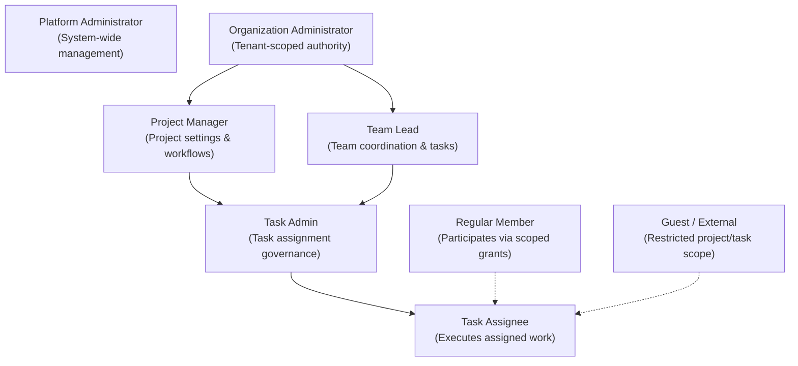
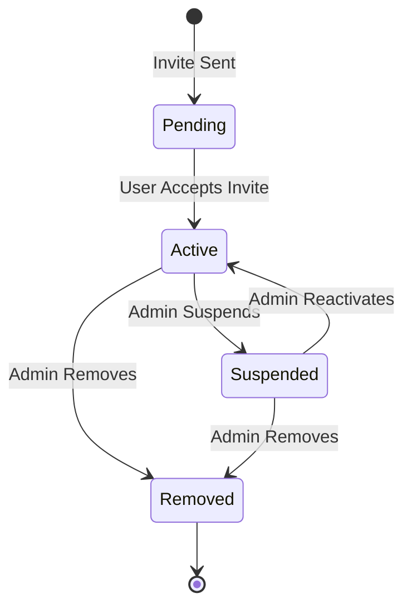
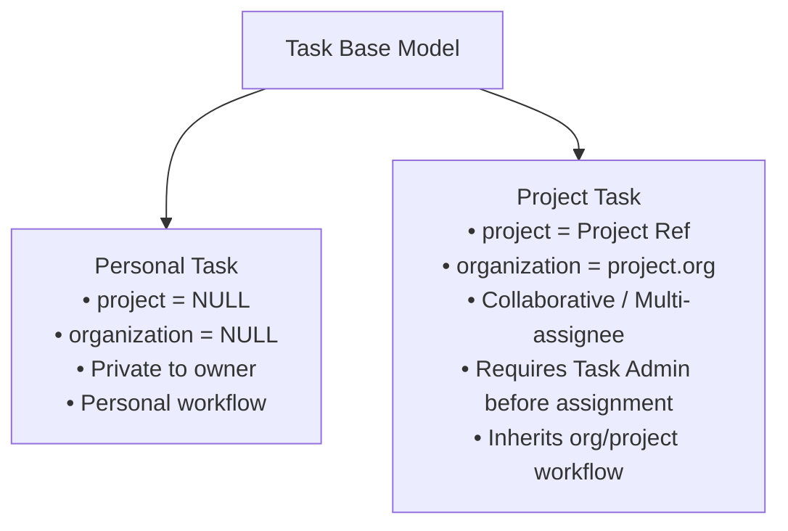
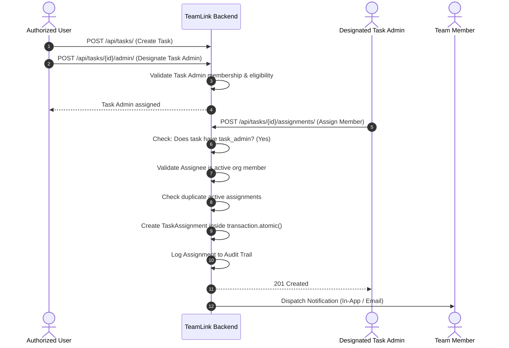

# TeamLink — Functional Requirements Specification (FRS)

**Document Version:** 1.0  
**Project Type:** Multi-tenant task and team management platform  
**Backend:** Django 5.2 & Django REST Framework (DRF) 3.18  
**Database:** PostgreSQL (with `psycopg3` driver)  
**Authentication:** Firebase Authentication (Admin SDK)  
**API Documentation:** OpenAPI 3.0 / Swagger UI (`drf-spectacular`)  

---

## Table of Contents

1. [Introduction](#1-introduction)
   - 1.1 [Purpose](#11-purpose)
   - 1.2 [Objectives](#12-objectives)
   - 1.3 [Scope](#13-scope)
2. [User Types and Actors](#2-user-types-and-actors)
   - 2.1 [Platform Administrator](#21-platform-administrator)
   - 2.2 [Organization Administrator](#22-organization-administrator)
   - 2.3 [Team Lead](#23-team-lead)
   - 2.4 [Project Manager](#24-project-manager)
   - 2.5 [Task Admin](#25-task-admin)
   - 2.6 [Task Assignee](#26-task-assignee)
   - 2.7 [Regular Member](#27-regular-member)
   - 2.8 [Guest or External Collaborator](#28-guest-or-external-collaborator)
3. [Account and Identity Management](#3-account-and-identity-management)
   - 3.1 [User Registration & Authentication](#31-user-registration--authentication)
   - 3.2 [Shared Identity](#32-shared-identity)
   - 3.3 [User Profile](#33-user-profile)
   - 3.4 [Account Deactivation](#34-account-deactivation)
4. [Organization Management](#4-organization-management)
   - 4.1 [Organization Creation](#41-organization-creation)
   - 4.2 [Organization Settings](#42-organization-settings)
   - 4.3 [Organization Membership](#43-organization-membership)
   - 4.4 [Tenant Isolation](#44-tenant-isolation)
5. [Teams](#5-teams)
   - 5.1 [Team Creation](#51-team-creation)
   - 5.2 [Team Membership](#52-team-membership)
   - 5.3 [Team Permissions](#53-team-permissions)
6. [Project Management](#6-project-management)
   - 6.1 [Project Creation](#61-project-creation)
   - 6.2 [Project Membership and Access](#62-project-membership-and-access)
   - 6.3 [Project Lifecycle](#63-project-lifecycle)
7. [Task Management](#7-task-management)
   - 7.1 [Task Types (Personal vs. Project)](#71-task-types)
   - 7.2 [Task Information Schema](#72-task-information-schema)
   - 7.3 [Task Creation](#73-task-creation)
   - 7.4 [Task Updates](#74-task-updates)
   - 7.5 [Task Status and Priority](#75-task-status-and-priority)
   - 7.6 [Subtasks](#76-subtasks)
   - 7.7 [Comments](#77-comments)
   - 7.8 [Task Dependencies](#78-task-dependencies)
8. [Task Administration and Assignments](#8-task-administration-and-assignments)
   - 8.1 [Task Admin Invariant Rule](#81-task-admin-invariant-rule)
   - 8.2 [Assignment Workflow](#82-assignment-workflow)
   - 8.3 [Assignment Rules](#83-assignment-rules)
   - 8.4 [Membership Removal and Reassignment](#84-membership-removal-and-reassignment)
   - 8.5 [Task Completion](#85-task-completion)
9. [Dynamic Permission Management](#9-dynamic-permission-management)
   - 9.1 [Action-Based Permission Model](#91-action-based-permission-model)
   - 9.2 [Hierarchical Permission Scopes](#92-hierarchical-permission-scopes)
   - 9.3 [Direct Permission Grants](#93-direct-permission-grants)
   - 9.4 [Reusable Permission Bundles](#94-reusable-permission-bundles)
   - 9.5 [Custom Roles](#95-custom-roles)
   - 9.6 [Explicit Denials Precedence](#96-explicit-denials-precedence)
   - 9.7 [Permission Administration](#97-permission-administration)
10. [Workflow Management](#10-workflow-management)
    - 10.1 [Purpose](#101-purpose)
    - 10.2 [Workflow Structure](#102-workflow-structure)
    - 10.3 [Workflow Examples](#103-workflow-examples)
    - 10.4 [Workflow Inheritance & Overrides](#104-workflow-inheritance--overrides)
    - 10.5 [Transition Validation](#105-transition-validation)
    - 10.6 [Approval Steps](#106-approval-steps)
11. [Custom Fields](#11-custom-fields)
    - 11.1 [Purpose](#111-purpose)
    - 11.2 [Configuration](#112-configuration)
    - 11.3 [Inheritance](#113-inheritance)
12. [Notifications](#12-notifications)
    - 12.1 [Notification Events](#121-notification-events)
    - 12.2 [Organization Policies](#122-organization-policies)
    - 12.3 [User Preferences](#123-user-preferences)
    - 12.4 [Notification Processing Engine](#124-notification-processing-engine)
13. [Audit and Activity History](#13-audit-and-activity-history)
    - 13.1 [Purpose](#131-purpose)
    - 13.2 [Audited Events](#132-audited-events)
    - 13.3 [Audit Record Structure](#133-audit-record-structure)
    - 13.4 [Audit Security & Immutability Rules](#134-audit-security--immutability-rules)
14. [API Functional Requirements](#14-api-functional-requirements)
    - 14.1 [Account APIs](#141-account-apis)
    - 14.2 [Organization APIs](#142-organization-apis)
    - 14.3 [Team APIs](#143-team-apis)
    - 14.4 [Project APIs](#144-project-apis)
    - 14.5 [Task APIs](#145-task-apis)
    - 14.6 [Permission APIs](#146-permission-apis)
    - 14.7 [Workflow APIs](#147-workflow-apis)
    - 14.8 [API Standards & Documentation](#148-api-standards--documentation)
15. [Security and Data Integrity](#15-security-and-data-integrity)
    - 15.1 [Authentication Security](#151-authentication-security)
    - 15.2 [Authorization Security](#152-authorization-security)
    - 15.3 [Data Integrity](#153-data-integrity)
    - 15.4 [Error Handling](#154-error-handling)
16. [Non-Functional Requirements](#16-non-functional-requirements)
    - 16.1 [Performance](#161-performance)
    - 16.2 [Scalability](#162-scalability)
    - 16.3 [Maintainability](#163-maintainability)
    - 16.4 [Reliability](#164-reliability)
    - 16.5 [Privacy](#165-privacy)
17. [Main Business Rules](#17-main-business-rules)
18. [Acceptance Criteria](#18-acceptance-criteria)
19. [Development Phases](#19-development-phases)
20. [Final Product Definition](#20-final-product-definition)

---

# 1. Introduction

## 1.1 Purpose
TeamLink is a multi-tenant task management and team collaboration platform designed to support individuals, teams, projects, and multiple organizations through a single application.

The platform provides centralized user identity, organization-specific memberships, dynamic permissions, task assignment governance, customizable workflows, notifications, and immutable audit history.

This document defines the functional behavior and business rules of the application. It serves as the authoritative functional baseline for database design, backend development, API implementation, testing, and frontend integration.

## 1.2 Objectives
The system must:
1. Allow users to manage personal tasks.
2. Allow organizations to manage teams, projects, and collaborative tasks.
3. Support multiple organizations with strict data isolation.
4. Allow one user account to participate in multiple organizations.
5. Provide configurable, action-based permissions rather than relying on fixed roles.
6. Support reusable permission bundles and direct permission grants.
7. Require a Task Admin before a task can be assigned.
8. Support organization-default workflows and project-specific customization.
9. Provide configurable notifications and user preferences.
10. Maintain an audit trail of important operations.
11. Support secure authentication through Firebase.
12. Expose functionality through documented REST APIs.

## 1.3 Scope

### In Scope
- User accounts and profiles
- Firebase authentication and social login
- Organization registration and management
- Organization memberships
- Teams and team memberships
- Projects
- Personal and collaborative tasks
- Task assignments and administration
- Dynamic permissions and custom roles
- Reusable permission bundles
- Configurable workflows and approvals
- Custom task fields
- Notifications and email preferences
- Audit logs
- API documentation and automated testing

### Out of Scope for the Initial Release
- Real-time video meetings
- Integrated chat messaging
- Payroll and HR management
- Full document management
- Native Android and iOS applications
- Billing and subscription management

---

# 2. User Types and Actors

The system uses permissions to determine what a user can do. The following actors describe common responsibilities, not mandatory fixed roles.



## 2.1 Platform Administrator
Responsible for platform-level management.
- Manage organizations (creation, suspension, reactivation).
- Investigate platform-level issues.
- Manage platform configuration and infrastructure.
- Grant platform-level administrative permissions.
- Access authorized platform audit information.

> [!CAUTION]
> A platform administrator must not automatically receive unrestricted access to every organization's business data unless explicitly authorized by the platform's security policy.

## 2.2 Organization Administrator
Responsible for managing one organization tenant.
- Update organization details and settings.
- Invite, approve, suspend, and remove members.
- Create and manage teams and projects.
- Configure permissions, reusable bundles, and custom roles.
- Configure organization default workflows.
- Configure notification policies and custom fields.
- View authorized organization audit records.

An organization administrator's authority is strictly restricted to their relevant organization.

## 2.3 Team Lead
Responsible for coordinating a team within an organization.
- View team information and roster.
- Manage team membership when authorized.
- Create or manage team tasks.
- Assign tasks within the permitted scope.
- Reassign tasks when an assignee loses membership, when authorized.
- Review team task progress.

A Team Lead receives these capabilities only through applicable permissions.

## 2.4 Project Manager
Responsible for managing a project deliverable.
- Manage project settings and milestones.
- Create project tasks.
- Configure project-specific workflow overrides.
- Manage project task assignments.
- View project progress and burndown.
- Configure project custom fields.
- Manage project-level permissions when authorized.

## 2.5 Task Admin
Every collaborative task must have a designated Task Admin before assignments can be made.
- Responsible for the administrative operations permitted on that task, especially assigning and managing assignees.
- Accountable for task delivery review and governance.
- The Task Admin is not automatically authorized to perform every possible task action; permission checks still apply.

## 2.6 Task Assignee
A user assigned to execute work on a task.
- View the assigned task and specifications.
- Update permitted task fields (e.g., progress, work notes).
- Change task status through allowed workflow transitions.
- Add comments and discussion items.
- Complete assigned work.

An assignment does not automatically grant unrestricted access to the organization, project, or unrelated tasks.

## 2.7 Regular Member
A user who participates in an organization, team, or project. Capabilities depend on direct permission grants, reusable bundles, membership status, scope, and explicit denials.

## 2.8 Guest or External Collaborator
An optional future capability for external users who need restricted access to selected projects or tasks without broad organization membership. If implemented, guests must be restricted to explicitly authorized resources.

---

# 3. Account and Identity Management

## 3.1 User Registration & Authentication
The system supports user authentication through Firebase Authentication (email/password, Google sign-in, and other configured social providers). Firebase verifies credentials and issues ID tokens; Django manages application-level identity, profiles, memberships, and permissions.

### Functional Requirements

| Req ID | Requirement Statement |
| :--- | :--- |
| **ACC-001** | Authenticate users using valid Firebase ID tokens passed via `Authorization: Bearer <TOKEN>`. |
| **ACC-002** | Reject expired, invalid, revoked, or unacceptable tokens with HTTP 401 Unauthorized. |
| **ACC-003** | Map authenticated Firebase identities to local user records (`accounts.User`). |
| **ACC-004** | Maintain a unique `firebase_uid` mapping for each user. |
| **ACC-005** | Prevent duplicate local accounts for the same Firebase identity. |
| **ACC-006** | Support user profile retrieval and updates via `/api/accounts/me/`. |
| **ACC-007** | Support account activation and deactivation states. |
| **ACC-008** | Prevent inactive accounts from accessing protected resources. |
| **ACC-009** | Avoid trusting client-supplied user IDs or organization IDs as proof of identity. |
| **ACC-010** | Ensure social login providers are configured and verified through Firebase Admin SDK. |

## 3.2 Shared Identity
A user has one global account, even when participating in multiple organizations.
- A user can belong to Organization A as a project coordinator, Organization B as an assignee, and Organization C as a read-only member.
- Each organization maintains its own membership record and independent permissions.
- Authorization is evaluated separately for each organization and resource.

## 3.3 User Profile
User profiles contain:
- Name (`first_name`, `last_name`, `username`)
- Email (`email`, verified flag)
- Profile image / avatar URL
- Contact information
- Account creation timestamp (`date_joined`)
- Account status (`is_active`)
- Last activity timestamp

> [!SECURITY]
> Authentication credentials, password hashes, and Firebase tokens must never be stored as ordinary profile fields.

## 3.4 Account Deactivation
When a user is deactivated:
- New authenticated access must be rejected immediately.
- Active application sessions or tokens are revoked according to policy.
- Existing task records, comments, and audit history must be preserved.
- Organization memberships are suspended, not silently deleted.
- Active task assignments requiring reassignment follow organizational reassignment policies.

---

# 4. Organization Management

## 4.1 Organization Creation
An authenticated user with the appropriate platform permission can create an organization tenant.
- Required: Organization name, unique identifier/slug.
- Optional: Description, logo/branding.
- The creator receives initial administrative permissions according to the organization creation policy.

## 4.2 Organization Settings
Authorized administrators can configure:
- Organization name and description
- Membership policies and invitation expiration rules
- Organization-default workflow
- Organization notification policies
- Tenant custom fields
- Permission configuration and role bundles

## 4.3 Organization Membership
A membership connects a global user account to an organization tenant.

### Membership States


### Functional Requirements

| Req ID | Requirement Statement |
| :--- | :--- |
| **ORG-001** | Users may belong to multiple organizations concurrently. |
| **ORG-002** | Each user can have only one membership record per organization (`unique_org_user_membership`). |
| **ORG-003** | Organization administrators can invite or add members when authorized. |
| **ORG-004** | Membership activation must follow the configured invitation policy. |
| **ORG-005** | Suspended or removed members cannot access protected organization resources. |
| **ORG-006** | Membership removal must not delete historical task or audit records. |
| **ORG-007** | Permissions belonging to a removed membership must no longer authorize access. |
| **ORG-008** | Users must be able to list and identify all their accessible organizations. |
| **ORG-009** | Organization-specific settings and permissions must not leak between tenants. |

## 4.4 Tenant Isolation
Organization data must remain strictly isolated. A member of Organization A must never access Organization B's data by manipulating URLs, IDs, or query parameters.
- Enforced through:
  - Base queryset filtering (`TenantQuerySet` / `TenantManager`).
  - Object-level permission checks (`check_object_permissions`).
  - Foreign key and cross-table validation in `clean()` methods.
  - PostgreSQL database constraints.
  - The frontend is never the sole enforcement point.

---

# 5. Teams

## 5.1 Team Creation
Authorized users can create teams inside an organization. Each team belongs to exactly one parent organization.

## 5.2 Team Membership
- Teams contain users who hold active membership in the parent organization.
- System validates that a user is an active member of `team.organization` before adding them to a `TeamMembership`.
- Historical task records are preserved when team membership changes.
- Prevents cross-organization team membership.

## 5.3 Team Permissions
Team-level permission grants apply strictly to the relevant team and its eligible resources. A Team Lead managing one team does not receive authority over other teams.

---

# 6. Project Management

## 6.1 Project Creation
A project belongs to one organization tenant.
- Attributes: Name, description, creator, organization, status, workflow override, custom fields, timestamps.
- Archival flag (`is_archived`) supports soft-retention.

## 6.2 Project Membership and Access

| Req ID | Requirement Statement |
| :--- | :--- |
| **PRJ-001** | Create projects within an organization tenant. |
| **PRJ-002** | Restrict project management to authorized users. |
| **PRJ-003** | Support project-specific permissions. |
| **PRJ-004** | Support workflow overrides where authorized. |
| **PRJ-005** | Support project-scoped custom fields. |
| **PRJ-006** | Prevent access to unauthorized project data across tenant boundaries. |
| **PRJ-007** | Preserve historical task and audit records when a project is archived. |
| **PRJ-008** | Validate that all project tasks belong to the parent project's organization. |

## 6.3 Project Lifecycle
Projects move through lifecycle states:
- `Active` $\rightarrow$ `On Hold` $\rightarrow$ `Completed` $\rightarrow$ `Archived`.
- Project state transitions are permission-controlled.
- Archiving restricts further modifications while preserving all tasks and history.

---

# 7. Task Management

## 7.1 Task Types



### Personal Tasks
- Owned by an individual user.
- Do not require an organization or project (`project = NULL`, `organization = NULL`).
- Private to the owner by default.
- Can be shared only through explicit user authorization.

### Project Tasks
- Associated with a project and organization.
- Support collaborative workflows and multiple assignees.
- Enforce the **Task Admin requirement** before assignees can be added.
- Follow project/organization access policies and approval workflows.

## 7.2 Task Information Schema
- Identifiers: `id`, `title`, `description`.
- Relationships: `created_by`, `owner`, `organization`, `project`, `task_admin`, `parent_task`.
- Lifecycle & Scheduling: `status`, `priority` (`LOW`, `MEDIUM`, `HIGH`, `CRITICAL`), `due_date`, `created_at`, `updated_at`.
- Sub-entities: `assignments`, `comments`, `custom_field_values`, `dependencies`.

## 7.3 Task Creation

| Req ID | Requirement Statement |
| :--- | :--- |
| **TSK-001** | Validate required task information (title, owner, creator). |
| **TSK-002** | Associate project tasks with a valid project. |
| **TSK-003** | Ensure organization and project relationships are consistent (`task.org == project.org`). |
| **TSK-004** | Establish valid task ownership. |
| **TSK-005** | Apply the appropriate default workflow (org default or project override). |
| **TSK-006** | Validate creator's permission to author tasks in the requested scope (`task.create`). |
| **TSK-007** | Record task creation in the audit trail. |

## 7.4 Task Updates
- Updates require permissions for the specific action and scope (`task.update`).
- Assignees may update task progress notes and execute permitted status transitions.
- Task Admins can manage assignments.
- Project Managers can edit project task details.
- Field-level permissions prevent unauthorized updates.

## 7.5 Task Status and Priority
- Default statuses: `To Do`, `In Progress`, `Blocked`, `In Review`, `Done`, `Cancelled`.
- Default priorities: `Low`, `Medium`, `High`, `Critical`.
- Workflows can configure custom statuses and allowed transitions.

## 7.6 Subtasks
- A subtask must reference a valid `parent_task`.
- Parent and child tasks must belong to the exact same organization and project.
- Self-referencing and circular parent-child hierarchies are prevented.
- Maximum hierarchy nesting depth is bounded (default depth: 3) to protect query performance.
- Archiving a parent preserves child historical records.

## 7.7 Comments
- Validate task access before reading or adding comments.
- Record comment author (`created_by`) and timestamp.
- Comments are immutable or strictly auditable upon edit/deletion.
- Support notifications on user mentions.

## 7.8 Task Dependencies
- Tasks can depend on prerequisite tasks (e.g., Task B cannot begin until Task A completes).
- Self-dependencies and circular chains are prevented.
- Backend validates dependency rules when status transitions are attempted.

---

# 8. Task Administration and Assignments

## 8.1 Task Admin Invariant Rule

> [!IMPORTANT]
> **Every task must have a designated, valid Task Admin before any assignee can be added.**  
> Attempting to create a `TaskAssignment` when `task.task_admin` is null must be rejected with error code `TASK_ADMIN_REQUIRED`.

The Task Admin is responsible for governing task scope, assignees, and progress review. The Task Admin must be an active member of `task.organization`.

## 8.2 Assignment Workflow



## 8.3 Assignment Rules

| Req ID | Requirement Statement |
| :--- | :--- |
| **ASN-001** | No assignee can be added before a valid Task Admin is designated (`task.task_admin != NULL`). |
| **ASN-002** | Only authorized users (Task Admin or users with `task.assign`) can assign tasks. |
| **ASN-003** | Assignees must hold active membership in `task.organization`. |
| **ASN-004** | Personal task sharing must follow the owner's explicit permissions. |
| **ASN-005** | Project task assignments must respect project and tenant boundaries. |
| **ASN-006** | Duplicate active assignments for the same user on a task are strictly prevented. |
| **ASN-007** | Assignment changes must be recorded in the audit trail. |
| **ASN-008** | Removing an assignment must preserve historical assignment records. |
| **ASN-009** | Reassignment must validate the new assignee's eligibility and permissions. |

## 8.4 Membership Removal and Reassignment
If an assignee loses membership or access to the organization/project:
- Their access is immediately revoked by authorization filters.
- Existing task and assignment records are preserved for audit history.
- The assignment status transitions to `REMOVED`.
- The system flags active assignments requiring attention.
- The Task Admin or authorized Team Lead reassigns those tasks to eligible members.
- All reassignment events are audited and notified.

## 8.5 Task Completion
- A task can only be marked completed via an allowed workflow transition.
- If approval steps are required, completion requires approval sign-off.
- Completion timestamps and historical records are preserved.

---

# 9. Dynamic Permission Management

## 9.1 Action-Based Permission Model
Permissions are defined as discrete actions (e.g., `task.create`, `task.assign`, `workflow.configure`) rather than hardcoded role names.

## 9.2 Hierarchical Permission Scopes

| Scope | Scope Target | Coverage |
| :--- | :--- | :--- |
| **`PLATFORM`** | System-wide | Global operations across all tenants. |
| **`ORGANIZATION`** | Organization Tenant | Operations across all teams, projects, and tasks in the org. |
| **`TEAM`** | Specific Team | Operations involving the team and its resources. |
| **`PROJECT`** | Specific Project | Operations restricted to the project workspace. |
| **`TASK`** | Specific Task | Granular control over a single task entity. |

A grant at one scope never confers unrestricted access to unrelated scopes.

## 9.3 Direct Permission Grants
Authorized administrators can grant specific actions directly to a user at a defined scope (e.g., `task.assign` for Project A only).
- Grant specifies: user, permission action, scope type, scope identifier, authorizer, expiration (`expires_at`), and status.

## 9.4 Reusable Permission Bundles
Administrators can group atomic actions into reusable bundles (e.g., "Project Coordinator Bundle": `project.view`, `task.create`, `task.update`, `task.assign`).
- Bundles can be assigned to eligible users at any scope.
- Updates to a bundle dynamically apply to active assignments.

## 9.5 Custom Roles
Named collections of permissions configured per organization (e.g., "Release Lead", "Quality Reviewer"). Custom roles are data-driven, requiring no code modifications or migrations.

## 9.6 Explicit Denials Precedence

```
Explicit Denial  >  Task Grant  >  Project Grant  >  Team Grant  >  Org Grant  >  Default Deny
```

> [!IMPORTANT]
> **Explicit denials always take precedence over positive grants.**  
> If a user receives `task.update` at the project level but has an `ExplicitDenial` for Task #123, access to update Task #123 is rejected.

## 9.7 Permission Administration

| Req ID | Requirement Statement |
| :--- | :--- |
| **PER-001** | Define and maintain an atomic permission catalog (`PermissionAction`). |
| **PER-002** | Grant individual actions directly to users at supported scopes. |
| **PER-003** | Create reusable permission bundles. |
| **PER-004** | Create configurable, named roles within organizations. |
| **PER-005** | Apply grants across all 5 scopes (`Platform`, `Org`, `Team`, `Project`, `Task`). |
| **PER-006** | Support explicit denials that override positive grants at any tier. |
| **PER-007** | Revoke permissions immediately without corrupting audit history. |
| **PER-008** | Prevent administrators from granting permissions beyond their own authority. |
| **PER-009** | Validate permissions on every protected API operation. |
| **PER-010** | Record all permission grants, denials, and updates in the audit trail. |

---

# 10. Workflow Management

## 10.1 Purpose
Workflows define the ordered statuses and valid transition pathways through which tasks progress.

## 10.2 Workflow Structure
- Attributes: Name, description, organization, active status.
- Statuses (`WorkflowStatus`): `name`, `category` (`TODO`, `IN_PROGRESS`, `DONE`, `CANCELLED`), `is_initial`, `is_final`.
- Transitions (`WorkflowTransition`): `from_status`, `to_status`, `required_permission`, `requires_approval`.

## 10.3 Workflow Examples
- **Development Workflow:** `Backlog` $\rightarrow$ `To Do` $\rightarrow$ `In Progress` $\rightarrow$ `In Review` $\rightarrow$ `Done`
- **HR Approval Workflow:** `Requested` $\rightarrow$ `Under Review` $\rightarrow$ `Approved` $\rightarrow$ `Completed`

## 10.4 Workflow Inheritance & Overrides
- Organization defines a default workflow.
- Projects inherit the organization default unless an authorized override is configured.
- Project-level customizations affect only that project.
- Changes to default workflows do not invalidate existing task statuses.

## 10.5 Transition Validation
When changing task status, the backend validates:
1. Current status matches transition source (`from_status`).
2. Requested target status is an allowed target (`to_status`).
3. User possesses the transition permission (`required_permission`).
4. Mandatory approvals have been completed.
5. Task dependencies have been satisfied.
- Any validation failure rolls back the update without partial changes.

## 10.6 Approval Steps
- Workflows can designate transition approval gates.
- Records: approver, decision (`APPROVED` / `REJECTED`), decision timestamp, notes.
- Tasks cannot transition to downstream states while required approvals are pending.

---

# 11. Custom Fields

## 11.1 Purpose
Allows organizations and projects to capture domain-specific task data (e.g., ticket ID, cost code, client reference, estimated hours).

## 11.2 Configuration
- Field attributes: Name, field key, data type, required flag, validation rules, default value, scope (`ORG` or `PROJECT`).
- Supported data types: `Text`, `Number`, `Date`, `Boolean`, `Single Select`, `Multi Select`.

## 11.3 Inheritance
- Projects inherit organization-level custom fields.
- Projects can define additional project-scoped custom fields.
- Field deprecation or deletion preserves historical values recorded on existing tasks.

---

# 12. Notifications

## 12.1 Notification Events
Events triggering notifications include:
- Task assignment and reassignment
- Due-date reminders
- Comments and user `@mentions`
- Status transitions and workflow updates
- Approval requests and decisions
- Organization and team membership changes
- Administrative role grants

## 12.2 Organization Policies
Organization administrators configure tenant-level notification rules:
- Enabled notification channels (in-app, email)
- Mandatory notifications (e.g., security, assignment notices)
- Reminder intervals

## 12.3 User Preferences
Users can configure personal preferences within organizational limits (e.g., opt out of comment notifications).
- **Rule:** User preferences cannot disable mandatory organization notifications.

## 12.4 Notification Processing Engine
- Recipient eligibility and tenant membership are verified prior to delivery.
- Messages never leak confidential details across tenant boundaries.
- Delivery failures are logged and retried via background tasks.
- Notification dispatch is decoupled from business logic; notification failure never aborts the underlying database transaction.

---

# 13. Audit and Activity History

## 13.1 Purpose
Provides an immutable, tamper-proof audit trail for security compliance, administrative review, and troubleshooting.

## 13.2 Audited Events
- Tenant creation, configuration updates, and suspensions
- Membership additions, role modifications, and removals
- Project and team lifecycle changes
- Task creation, modification, status transitions, and deletions
- Task Admin designations and task assignments
- Workflow configurations and approval decisions
- Permission grants, custom role edits, and explicit denials

## 13.3 Audit Record Structure
- `id`: Unique surrogate key
- `actor`: User who initiated the action
- `action`: Specific operation performed (e.g., `task.assign`)
- `resource_type`: Target entity name (e.g., `Task`, `Project`)
- `resource_id`: Primary key of target entity
- `organization`: Tenant scope
- `timestamp`: UTC timestamp of event
- `changes`: JSON metadata containing before/after diffs
- `outcome`: `SUCCESS` or `FAILED`

## 13.4 Audit Security & Immutability Rules
- Audit records are append-only; update and delete operations are prohibited.
- Audit history is preserved even if target resources are deleted.
- Credentials, tokens, and secret keys must never appear in change metadata.
- Access to audit logs requires explicit permission (`audit.view`).

---

# 14. API Functional Requirements

All client interactions occur through documented REST APIs authenticated with Firebase ID tokens.

## 14.1 Account APIs
- `GET /api/accounts/me/` — Retrieve authenticated user profile.
- `PATCH /api/accounts/me/` — Update user profile and notification preferences.
- `GET /api/accounts/organizations/` — List all organizations accessible to the user.
- `POST /api/accounts/sync/` — Sync profile details from Firebase token claims.

## 14.2 Organization APIs
- `GET /api/organizations/` — List user's tenant organizations.
- `POST /api/organizations/` — Register a new organization tenant.
- `GET /api/organizations/{slug}/` — Retrieve organization details (`organization.view`).
- `PATCH /api/organizations/{slug}/` — Update organization settings (`organization.update`).
- `GET /api/organizations/{slug}/members/` — List tenant members (`organization.view`).
- `POST /api/organizations/{slug}/members/` — Invite / add a member (`organization.manage_members`).
- `DELETE /api/organizations/{slug}/members/{user_id}/` — Remove member (`organization.manage_members`).

## 14.3 Team APIs
- `GET /api/organizations/{slug}/teams/` — List teams within an organization.
- `POST /api/organizations/{slug}/teams/` — Create team (`team.create`).
- `GET /api/teams/{id}/` — Retrieve team details.
- `PATCH /api/teams/{id}/` — Update team details (`team.update`).
- `POST /api/teams/{id}/members/` — Add user to team (`team.manage_members`).
- `DELETE /api/teams/{id}/members/{user_id}/` — Remove user from team (`team.manage_members`).

## 14.4 Project APIs
- `GET /api/organizations/{slug}/projects/` — List organization projects.
- `POST /api/organizations/{slug}/projects/` — Create project workspace (`project.create`).
- `GET /api/projects/{id}/` — Retrieve project details (`project.view`).
- `PATCH /api/projects/{id}/` — Update project parameters (`project.update`).
- `POST /api/projects/{id}/archive/` — Archive project (`project.archive`).

## 14.5 Task APIs
- `GET /api/tasks/` — List tasks (filters: `is_personal`, `project`, `status`, `assigned_to`).
- `POST /api/tasks/` — Create task (`task.create`).
- `GET /api/tasks/{id}/` — Retrieve task details (`task.view`).
- `PATCH /api/tasks/{id}/` — Update task fields (`task.update`).
- `DELETE /api/tasks/{id}/` — Delete task (`task.delete`).
- `POST /api/tasks/{id}/admin/` — Designate or transfer Task Admin (`task.manage_admin`).
- `GET /api/tasks/{id}/assignments/` — List task assignees (`task.view`).
- `POST /api/tasks/{id}/assignments/` — Assign member (**enforces Task Admin rule!**) (`task.assign`).
- `DELETE /api/tasks/{id}/assignments/{id}/` — Remove assignment (`task.assign`).
- `POST /api/tasks/{id}/status/` — Transition task status (`workflow.transition`).
- `POST /api/tasks/{id}/comments/` — Add comment (`task.comment`).

## 14.6 Permission APIs
- `GET /api/permissions/catalog/` — Retrieve available atomic action catalog.
- `GET /api/permissions/bundles/` — List reusable permission bundles.
- `POST /api/permissions/bundles/` — Create reusable permission bundle (`permissions.manage`).
- `POST /api/permissions/grants/` — Create direct scoped grant (`permissions.manage`).
- `POST /api/permissions/denials/` — Create explicit denial (`permissions.manage`).
- `DELETE /api/permissions/grants/{id}/` — Revoke grant (`permissions.manage`).

## 14.7 Workflow APIs
- `GET /api/organizations/{slug}/workflows/` — List organization workflows.
- `POST /api/organizations/{slug}/workflows/` — Create workflow definition (`workflow.configure`).
- `GET /api/projects/{id}/workflow/` — Retrieve project active workflow.
- `PATCH /api/projects/{id}/workflow/` — Set project workflow override (`workflow.configure`).
- `POST /api/tasks/{id}/approvals/` — Submit approval decision (`workflow.transition`).

## 14.8 API Standards & Documentation
- Interactive OpenAPI 3.0 generated via `drf-spectacular` at `/api/docs/` (Swagger UI) and `/api/schema/` (OpenAPI JSON/YAML).
- Standard success envelope (`success`, `data`, `meta`) and error envelope (`success`, `error.code`, `error.message`, `error.details`).
- Pagination via `LimitOffsetPagination` or `PageNumberPagination`.

---

# 15. Security and Data Integrity

## 15.1 Authentication Security
- Firebase ID tokens verified server-side with `check_revoked=True`.
- Client-supplied claims are untrusted.
- Secrets loaded exclusively from environment variables.
- HTTPS required for all production deployments.

## 15.2 Authorization Security
- Permissions validated on every protected operation.
- Object-level security verifies user belongs to target tenant.
- Explicit denials always supersede positive grants.
- Revocation takes effect immediately.
- Privilege escalation is strictly prevented.

## 15.3 Data Integrity
- Foreign keys with strict deletion policies (`CASCADE`, `PROTECT`).
- Database-level unique constraints (`unique_org_user_membership`, `unique_active_task_assignment`).
- Complex multi-step operations executed inside `transaction.atomic()`.
- Circular task dependencies prevented.

## 15.4 Error Handling
Consistent HTTP status codes:
- `401 Unauthorized` — Missing or invalid authentication token.
- `403 Forbidden` — Insufficient permissions or explicit denial.
- `404 Not Found` — Resource does not exist or user lacks visibility.
- `400 Bad Request` — Schema validation or invariant violation.
- `409 Conflict` — State conflict or duplicate active assignment.

---

# 16. Non-Functional Requirements

| Metric | Target / Specification |
| :--- | :--- |
| **16.1 Performance** | Database indexes on lookups (`firebase_uid`, `email`, tenant keys); pagination on all lists; query optimization via `select_related()` and `prefetch_related()`. |
| **16.2 Scalability** | Multi-tenant horizontal partitioning; stateless API nodes; background job processing for emails and heavy tasks. |
| **16.3 Maintainability** | Modular Django apps (`accounts`, `organizations`, `permissions`, `tasks`, `commons`); centralized business services. |
| **16.4 Reliability** | Atomic transactions prevent partial writes; retry logic for background notifications; append-only audit trail. |
| **16.5 Privacy** | Strict cross-tenant isolation; personal tasks private by default; data retention policies enforced. |

---

# 17. Main Business Rules

1. A global user account can belong to multiple organizations.
2. Organization memberships and permissions are independent across tenants.
3. Organization data must remain strictly isolated.
4. Roles are configurable permission groupings, not hardcoded identities.
5. Permissions can be granted directly or through reusable bundles.
6. Permission scopes include `PLATFORM`, `ORGANIZATION`, `TEAM`, `PROJECT`, and `TASK`.
7. Explicit permission denials take precedence over all applicable grants.
8. Every task requires a valid Task Admin before any assignee can be added.
9. Task assignments must respect access and organization membership requirements.
10. Membership removal revokes access without deleting historical task records.
11. Authorized Task Admins or Team Leads may reassign affected tasks when membership ends.
12. Organization workflows provide defaults; projects may customize them.
13. Workflow transitions must be validated by the backend state machine.
14. Mandatory approvals must be completed before downstream workflow transitions.
15. Organization notification policies take precedence over conflicting optional user preferences.
16. Custom fields must respect their organization or project scope.
17. Audit records are immutable and protected from unauthorized modification.
18. Authentication does not imply authorization.
19. The frontend must never be the sole enforcement point for security rules.
20. Multi-step operations must preserve database integrity via atomic transactions.

---

# 18. Acceptance Criteria

### Account and Organization
- User authenticates via Firebase ID token and receives local profile.
- Same user can belong to Organization A and Organization B with different privileges.
- User in Org A cannot query or mutate Org B resources.

### Permissions
- Administrator can grant individual action and reusable bundles.
- Grant in Project A confers no rights in Project B.
- Explicit denial blocks an otherwise permitted action.
- Revoking a grant immediately stops access.

### Tasks & Governance
- Personal tasks remain private to owner.
- Attempting to add an assignee to a task without a `task_admin` returns `400 Bad Request` (`TASK_ADMIN_REQUIRED`).
- Designated Task Admin can add valid organization members as assignees.
- Duplicate active assignments are rejected.
- Membership removal revokes access while preserving task and assignment history.

### Workflows
- Organization defines default workflow; project inherits it.
- Authorized Project Manager configures project-level workflow override.
- Disallowed status transitions are rejected with descriptive error.
- Mandatory approval gates block transition until approved.

### Auditing & Notifications
- Task assignments and status changes generate audit records.
- Audit history cannot be altered or removed via the API.
- Mandatory tenant notifications are dispatched regardless of user opt-outs.

---

# 19. Development Phases

```
Phase 1: Foundation (Settings, PostgreSQL, Custom User Model, Config)
Phase 2: Accounts & Auth (Firebase Auth Backend, Profile APIs)
Phase 3: Organizations & Tenancy (Tenants, Memberships, Teams, Projects)
Phase 4: Dynamic Permissions (Action Catalog, 5 Scopes, Evaluation Engine)
Phase 5: Tasks & Governance (Personal/Project Tasks, Task Admin Invariant)
Phase 6: Workflows Engine (Custom Statuses, State Transition Guards, Approvals)
Phase 7: Notifications & Auditing (Event Log, Preferences, Email Dispatch)
Phase 8: Polish & Production Readiness (OpenAPI Docs, Test Coverage, Deployment)
```

---

# 20. Final Product Definition

TeamLink is a multi-tenant task management platform where a single user identity can participate across multiple independent organizations. Each organization can structure teams and projects, configure dynamic permissions, assign tasks, define custom workflows, and manage notifications.

The defining feature is its **dynamic, scope-based permission system**, which allows access to be configured through individual action grants and reusable permission bundles, with explicit denials taking precedence.

The **Task Admin requirement** ensures assignments are governed by an accountable administrator. Organization and project workflow customization supports diverse operational processes without requiring separate applications.

Django and Django REST Framework provide the business logic and API layer, PostgreSQL maintains relational integrity, Firebase handles authentication, and the audit system provides traceability.
