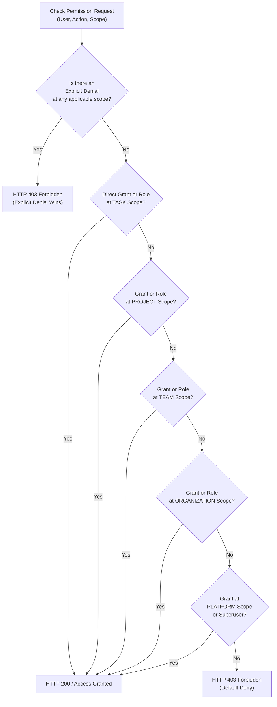
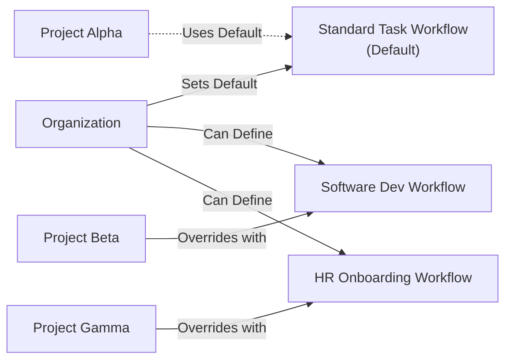
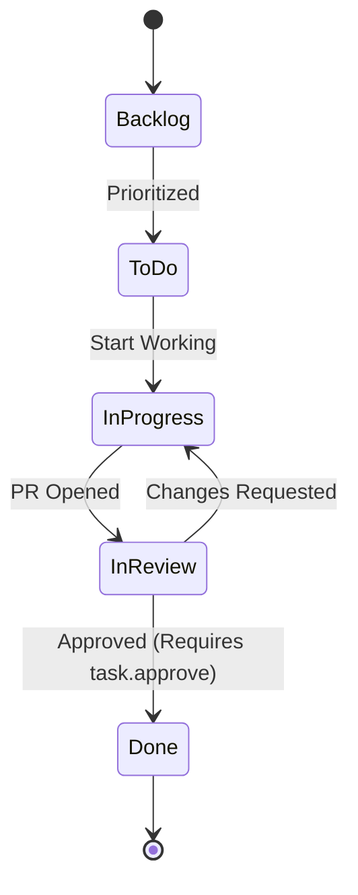

# TeamLink — Dynamic Permission & Workflow Systems

## 1. Dynamic Action-Based Permissions

Traditional systems rely on hardcoded roles (e.g., "Manager", "Member") or static Django group permissions. In TeamLink, authorization is **action-based, scoped, and dynamically configurable** by organization administrators without modifying backend code or database migrations.

### 1.1 Permission Scopes

Every authorization check evaluates the request context against five hierarchical scope levels:

| Scope Level | Description | Example Target |
| :--- | :--- | :--- |
| **`PLATFORM`** | Applies to global system administration. | Superusers, System Maintenance |
| **`ORGANIZATION`** | Applies across all teams, projects, and tasks in an organization. | Tenant Admin, HR Director |
| **`TEAM`** | Applies to resources and members within a specific team. | Engineering Lead, QA Lead |
| **`PROJECT`** | Applies strictly within a designated collaborative project workspace. | Project Manager, External Contractor |
| **`TASK`** | Granular control applied directly to a single task record. | Designated Task Admin, Reviewer |

---

## 2. Action Catalog

TeamLink groups atomic actions by domain:

### Organization Actions
- `organization.view` — View organization details and member directories.
- `organization.update` — Update organization settings, name, or metadata.
- `organization.manage_members` — Invite, accept, suspend, or remove tenant members.
- `organization.delete` — Archive or delete the organization tenant.

### Team Actions
- `team.create` — Form new teams within an organization.
- `team.update` — Edit team details and charter.
- `team.manage_members` — Add or remove members from the team.
- `team.delete` — Disband a team.

### Project Actions
- `project.create` — Create a project workspace within an organization.
- `project.view` — Access project overview, milestones, and task boards.
- `project.update` — Modify project parameters and assigned workflow.
- `project.archive` — Mark project as archived/read-only.
- `project.delete` — Permanently remove a project workspace.

### Task Actions
- `task.create` — Author a new personal or project task.
- `task.view` — View task details, comments, and attachments.
- `task.update` — Modify task title, description, priority, or due date.
- `task.delete` — Delete or cancel a task.
- `task.manage_admin` — Designate or transfer the Task Admin role.
- `task.assign` — Assign or unassign team members (requires valid Task Admin).
- `task.comment` — Post comments and discussion updates.

### Workflow & Governance Actions
- `workflow.configure` — Define statuses and transition rules for an org or project.
- `workflow.transition` — Execute protected status transitions (e.g., "Under Review" $\rightarrow$ "Approved").
- `permissions.manage` — Grant, revoke, or configure custom roles and scoped grants.
- `permissions.delegate` — Temporarily delegate specific permitted actions to another member.

---

## 3. Permission Evaluation Algorithm

When a user attempts an action (e.g., `task.assign` on Task #42 in Project #10 of Organization #2), the engine follows a deterministic precedence model:



### Precedence Rule:
$$\mathbf{Explicit\ Denial} \succ \mathbf{Task\ Scope\ Grant} \succ \mathbf{Project\ Scope\ Grant} \succ \mathbf{Team\ Scope\ Grant} \succ \mathbf{Org\ Scope\ Grant} \succ \mathbf{Default\ Deny}$$

### Time-Bounded Delegations
Grants can optionally carry an `expires_at` timestamp. The engine filters out expired grants automatically at query time:
```python
active_grants = ScopedGrant.objects.filter(
    user=user,
    role__actions__codename=action_codename
).filter(
    Q(expires_at__isnull=True) | Q(expires_at__gt=timezone.now())
)
```

---

## 4. Configurable Workflow Engine

TeamLink decouples task records from rigid status enums by providing a **Workflow State Machine**.

### 4.1 Hierarchical Workflows
1. **Organization Default Workflow:** Defined once per organization and applied to all new projects by default (e.g., "Standard Task Lifecycle").
2. **Project Custom Workflow:** Individual projects can link to a specialized workflow adapted to their domain (e.g., "Software Engineering", "Legal Compliance", "HR Onboarding").



### 4.2 State Machine Schema

- **`Workflow`**: Named container owned by an Organization.
- **`WorkflowStatus`**: A single status within the workflow (e.g., `Backlog`, `In Progress`, `Done`), marked with:
  - `name`: Display label.
  - `category`: `INITIAL`, `IN_PROGRESS`, `PAUSED`, `RESOLVED`, `CANCELLED`.
  - `order`: Numeric sort position for Kanban boards.
- **`WorkflowTransition`**: Directed edge connecting `from_status` $\rightarrow$ `to_status`.
  - `required_permission`: Nullable `PermissionAction` required to execute the transition.

### 4.3 Transition Example: Software Development Workflow



### 4.4 Transition Rules & Integrity
- **Guard Validation:** Status changes submitted via `PATCH /api/tasks/{id}/` are checked against `WorkflowTransition` records. If no valid edge exists between current status and requested status, the API rejects the request with HTTP 400 Bad Request.
- **Permission Guards:** If a transition defines a `required_permission`, the user performing the update must possess that permission at the task or project scope.
- **In-flight Consistency:** When an administrator edits a workflow, existing tasks retain their current status string. If a status is deleted from a workflow, the system flags affected tasks for migration before allowing status deletion.
